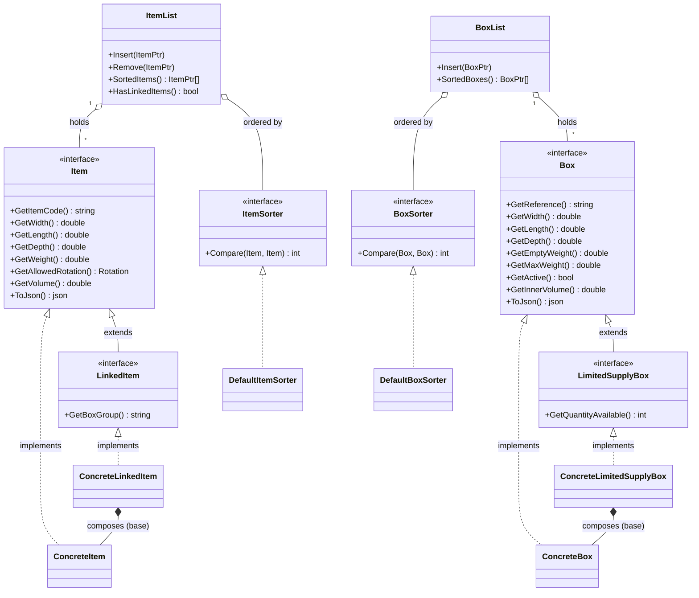
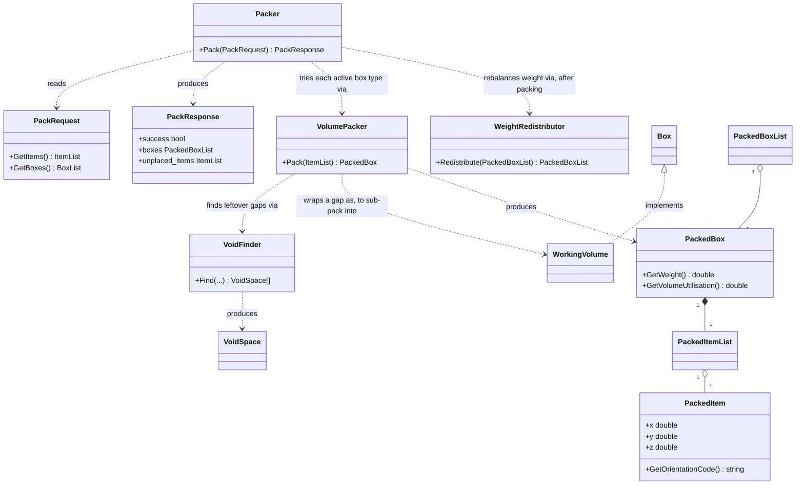

# FitSolver

A 3D bin-packing ("fit as many items into as few boxes as possible")
engine written in C++, exposed to Python as a native extension module
(`import fitsolver`) so other services/teams can call it without knowing
any C++. Also ships as a plain C ABI (for non-Python callers) and a CLI.
Wired up with CMake + Google Test + GitHub Actions CI, and a Docker/dev
container setup so nobody has to hand-install a C++ toolchain.

## What's included

```
CMakeLists.txt              # Root build config; fetches GoogleTest + pybind11
src/
  Item.h / LinkedItem.h        # Item interfaces -- implement your own, or use:
  ConcreteItem.h / .cpp        #   ConcreteItem / ConcreteLinkedItem (ready-made)
  Box.h / LimitedSupplyBox.h   # Box interfaces -- implement your own, or use:
  ConcreteBox.h / .cpp         #   ConcreteBox / ConcreteLimitedSupplyBox (ready-made)
  ItemSorter.h, DefaultItemSorter.h/.cpp   # Pluggable item packing-priority order
  BoxSorter.h, DefaultBoxSorter.h/.cpp     # Pluggable box try-order
  PackedBoxSorter.h, DefaultPackedBoxSorter.h/.cpp  # Pluggable "which box is better"
  ItemList.h/.cpp, BoxList.h/.cpp          # Ordered collections (the main way
                                             #   items/boxes are passed around)
  OrientatedItem.h/.cpp        # One candidate rotation of an item
  PackedItem.h/.cpp            # An item placed at a position, in an orientation
  PackedItemList.h/.cpp        # Items packed into one box
  PackedBox.h/.cpp             # A box + everything packed into it
  PackedBoxList.h/.cpp         # All boxes used by one packing run
  VoidSpace.h/.cpp, VoidFinder.h/.cpp  # Finds leftover rectangular gaps in a box
  WorkingVolume.h/.cpp         # A Box representing one such gap, for sub-packing
  VolumePacker.h/.cpp          # Packs items into ONE box instance
  WeightRedistributor.h/.cpp   # Post-pass: evens out weight between boxes used
  Packer.h/.cpp                # Top-level entry point: fitsolver::Packer().Pack(...)
  PackRequest.h/.cpp, PackResponse.h/.cpp  # Request/response + JSON (de)serialisation
  Rotation.h/.cpp               # Never / KeepFlat / BestFit
  JsonUtil.h                    # Small internal JSON-parsing helpers
  pymodule.cpp                  # Python bindings -- builds the `fitsolver` module
  abi.h / abi.cpp                # Plain C ABI (fitsolver_solve/fitsolver_free)
  main.cpp                       # fitsolver_app CLI: reads a JSON request, prints JSON
tests/
  packer_test.cpp             # Google Test suite for the C++ core
  test_solver.cpp             # Minimal standalone C++ usage sample
  test_fitsolver.py           # Manual smoke test for the Python module
  items.json / boxes.json     # Sample request data used by the tests/examples
example/
  simple_solve.py             # Easiest Python usage: JSON in, JSON out
  rich_api_example.py         # Feature-rich Python usage: real objects/attributes
  python_example.py           # Calling the C ABI directly via ctypes (no pybind11)
.github/workflows/ci.yml    # CI: build + test on every push/PR
.github/workflows/cd.yml    # CD: build + push Docker image to GHCR on merge to main
Dockerfile                  # Production image (slim, deployment)
Dockerfile.dev              # Dev environment image (full build/debug tools)
docker-compose.yml          # One-command way to spin up the dev environment
.devcontainer/               # VS Code "Reopen in Container" config
```
Third-party: nlohmann/json

All JSON (de)serialisation in the C++ core — PackRequest, PackResponse, Item/Box and their Concrete* implementations — is done with nlohmann/json, specifically v3.11.3.

It's vendored, not fetched. Unlike GoogleTest and pybind11 (which CMake downloads at configure time via FetchContent — see "Notes" below), nlohmann/json ships directly in the repo as a single header:

third_party/nlohmann/json.hpp

That means: no network access needed to build, no separate install step, nothing to add to the Dockerfile or dev container for it — it's just part of the source tree like any other header. If you ever need to upgrade it, replace that one file with a newer release's single-header amalgamation and update the version noted above.

It's wired into the build as a header-only INTERFACE library in the root CMakeLists.txt:

cmake
add_library(nlohmann_json INTERFACE)
target_include_directories(nlohmann_json INTERFACE ${CMAKE_SOURCE_DIR}/third_party)

fitsolver_core links against it PUBLIC, so every target built on top of it — fitsolver_app, fitsolver_lib, fitsolver_tests, the fitsolver Python module — gets #include <nlohmann/json.hpp> for free, with no per-target setup.

Usage pattern. Every serialisable type exposes a ToJson() method returning nlohmann::json; parent objects build up their JSON by assigning into a nlohmann::json and nesting child objects' own ToJson() calls, e.g. PackResponse::ToJson() in src/PackResponse.cpp:

cpp
nlohmann::json PackResponse::ToJson() const {
  nlohmann::json j;
  j["success"] = success;

  nlohmann::json boxes_json = nlohmann::json::array();
  for (const auto& box : boxes) {
    nlohmann::json box_json = box.ToJson();   // Box has its own ToJson()
    box_json["box_index"] = box_index;
    boxes_json.push_back(box_json);
    // ...
  }
  j["boxes"] = std::move(boxes_json);
  return j;
}

PackResponse::Dump(int indent) wraps this with .dump(indent) for a printable string — that's what fitsolver_app writes to stdout and what fitsolver.solve() returns to Python. See "Request / response JSON schema" below for the actual shape this produces.

The other direction — JSON in — follows the same shape in reverse. PackRequest exposes a static FromJson(const nlohmann::json&) that builds each collection from its corresponding array key, delegating each element to a MakeItemFromJson / MakeBoxFromJson helper (see ConcreteItem.h / ConcreteBox.h) rather than parsing fields inline, so per-item/per-box parsing logic stays in one place next to the type it constructs:

cpp
PackRequest PackRequest::FromJson(const nlohmann::json& j) {
  ItemList items;
  if (j.contains("items")) {
    for (const auto& item_json : j.at("items")) items.Insert(MakeItemFromJson(item_json));
  }

  BoxList boxes;
  if (j.contains("boxes")) {
    for (const auto& box_json : j.at("boxes")) boxes.Insert(MakeBoxFromJson(box_json));
  }

  return PackRequest(std::move(items), std::move(boxes));
}

j.contains(...) guards both keys, so a request with an empty/missing items or boxes array parses to an empty list rather than throwing — worth knowing if you're debugging a PackRequest that silently packed nothing. PackRequest::FromJsonString(const std::string&) is the convenience entry point most callers actually use — it just wraps nlohmann::json::parse() around FromJson(), and is what main.cpp and abi.cpp call after reading a request off stdin / across the C ABI.

## Architecture

See the class diagrams below for the shape of it -- but the short
version: `Item`/`Box` are interfaces (implement your own, or use the
ready-made `Concrete*` versions), `ItemList`/`BoxList` are how items and
boxes get passed around, and `Packer` is the one entry point that ties
everything together.

### Data model: Item, Box, and the collections that hold them



`LinkedItem` and `LimitedSupplyBox` are *optional* capabilities layered
on top of the base interface -- a plain `ConcreteItem` is not a
`LinkedItem`, so `dynamic_cast<const LinkedItem*>(item.get())` is how
the rest of the codebase checks "does this particular item need the
box-group constraint?" without every `Item` needing to carry that field.
Adding a new capability later (e.g. a constrained-placement item) means
adding one new interface + one dynamic_cast check, not touching any of
the classes above.

### Packing engine: how a request actually gets turned into boxes



`Packer` never talks to geometry directly -- it just keeps asking
`VolumePacker` "how much of what's left fits in one of these?" for each
active box type and keeps the best answer. `VolumePacker` does a greedy
shelf pass, then uses `VoidFinder`/`WorkingVolume` to squeeze more items
into whatever rectangular gaps are left over. See "How the algorithm
works" below for the full walkthrough.

## Python bindings (the `fitsolver` module)

### Build it

You need a C++17 compiler, CMake 3.18+, and a Python 3.8+ dev install
(headers + libs -- the regular python.org / Windows Store installer has
these; on Debian/Ubuntu install `python3-dev`). GoogleTest and pybind11
are fetched automatically by CMake -- nothing to install by hand for
those.

```bash
cmake -B build
cmake --build build --config Release
```

That produces, among other things, the Python module itself:

- Windows: `build/Release/fitsolver.cp3XX-win_amd64.pyd`
- Linux/macOS: `build/fitsolver.cpython-3XX-<platform>.so`

(`3XX` = whatever Python version CMake found; `--config Release` only
matters for the Visual Studio generator on Windows.)

### Run it

The Portal team just needs that one compiled file next to their script
(or on `PYTHONPATH`) -- copy it in, then:

```python
import fitsolver
```

Two quick ways to get it into place:

```bash
# Option A: copy it next to your script
cp build/Release/fitsolver.cp313-win_amd64.pyd my_project/    # Windows example
cp build/fitsolver.cpython-313-x86_64-linux-gnu.so my_project/ # Linux example

# Option B: point PYTHONPATH at the build output instead of copying
export PYTHONPATH="$PWD/build/Release:$PYTHONPATH"   # Windows (bash)
export PYTHONPATH="$PWD/build:$PYTHONPATH"           # Linux/macOS
```

Then run the examples (from the repo root, so the relative `tests/*.json`
paths resolve, or after copying the module into your own project):

```bash
python example/simple_solve.py       # simplest: JSON in, JSON out
python example/rich_api_example.py   # richer: real objects, .weight, .orientation, etc.
python example/python_example.py     # alternative: ctypes against the C ABI, no pybind11
```

### The three ways to call it

**1. Simplest -- JSON in, JSON out.** No `fitsolver` types to learn:

```python
import json, fitsolver

request = {"items": items, "boxes": boxes}  # see schema below
response = json.loads(fitsolver.solve(json.dumps(request)))
```

**2. Rich objects from plain dicts.** Same input shape, but you get back
real Python objects with attributes for every computed feature instead of
a JSON blob to parse:

```python
result = fitsolver.pack_dicts(items, boxes)   # items/boxes: list[dict]

result.success                 # bool
result.overall_volume_utilisation
for box in result.boxes:
    box.weight                 # empty weight + everything inside
    box.max_weight
    box.remaining_weight
    box.volume_utilisation     # percent used
    box.remaining_width / box.remaining_length / box.remaining_depth
    for item in box.items:
        item.x, item.y, item.z         # placed position
        item.width, item.length, item.depth  # placed (post-rotation) size
        item.orientation                # e.g. "WLD", "DWL" -- which axes were swapped
        item.rotated                    # bool
        item.item.item_code             # back-reference to the original input item

for item in result.unplaced_items:
    ...                          # items that didn't fit anywhere

result.to_dict()   # ...or just get the JSON-shaped dict if you want it after all
result.to_json()
```

**3. Rich objects built directly in Python**, if you'd rather construct
`fitsolver.Item(...)` / `fitsolver.Box(...)` than build dicts:

```python
item = fitsolver.Item("SKU-1", "Widget", width=100, length=200, depth=50, weight=1.0)
box = fitsolver.Box("SML", width=300, length=300, depth=300, max_weight=10.0)
result = fitsolver.pack([item], [box])
```

Every bound type (`Item`, `Box`, `PackedItem`, `PackedBox`, `PackResult`)
has a matching set of read-only attributes covering everything the C++
core computes -- see `src/pymodule.cpp` for the full list, or just
`dir(obj)` / `help(fitsolver)` in a REPL.

### Request / response JSON schema

Request:

```json
{
  "items": [
    {"ItemCode": "ITM-001", "ItemReference": "Widget A", "Width": 100, "Length": 200,
     "Depth": 50, "Weight": 1.0, "BoxGroup": "GROUP-A", "AllowedRotation": "BestFit"}
  ],
  "boxes": [
    {"Reference": "SML", "Width": 150, "Length": 150, "Depth": 150,
     "MaxWeight": 8.5, "BoxWeight": 0.5, "Active": true, "MaximumBoxes": 100}
  ]
}
```

`BoxGroup`, `AllowedRotation`, `MaxWeight`, `BoxWeight`, `Active`, and
`MaximumBoxes` are all optional (defaults: no group, `"BestFit"`
rotation, no weight limit, 0 empty weight, active, unlimited quantity).
`AllowedRotation` is one of `"Never"`, `"KeepFlat"`, `"BestFit"`.
`ItemCode` must be unique across the request. Items sharing a
non-empty `BoxGroup` are always kept together in the same box.

Response (`fitsolver.solve()` / `.to_json()` / `.to_dict()`):

```json
{
  "success": true,
  "boxes": [ { "box_reference": "...", "weight": ..., "volume_utilisation": ..., "items": [...] } ],
  "placements": [ { "ItemCode": "...", "x": ..., "y": ..., "z": ..., "orientation": "...", "box_reference": "..." } ],
  "unplaced_items": [ ... ],
  "unplaced_item_codes": [ "..." ],
  "summary": { "box_count": ..., "total_placed": ..., "total_unplaced": ..., "overall_volume_utilisation": ... }
}
```

`placements` is a flat list across all boxes (handy if you just want
"where did everything end up" without walking the `boxes` tree).

### How the algorithm works (and its limits)

The engine is split into cooperating classes, each in its own file under
`src/`, mirroring the DVDoug/BoxPacker PHP library's design:

- **`Packer`** is the entry point. It repeatedly picks, from the active
  box types (a `BoxList`), the single box instance that fits the most of
  what's still unplaced (a `ItemList`) -- ties broken by volume
  utilisation -- via `VolumePacker`, and repeats until nothing more
  fits. Items sharing a `BoxGroup` (`LinkedItem`) are only kept in a
  candidate box if *all* of that group made it in; otherwise they're
  pulled back out so they can be tried together elsewhere. If more than
  one box ends up used, `WeightRedistributor` runs afterwards to move
  items between boxes where that reduces weight variance without
  changing the box count.
- **`VolumePacker`** packs one box instance: a greedy shelf pass (items
  placed left-to-right, wrapping to a new row then a new vertical layer,
  largest items first, trying every orientation the item's
  `AllowedRotation` allows), then a void-filling pass that uses
  `VoidFinder` to locate leftover rectangular gaps and packs more items
  into each one (via `WorkingVolume`, a `Box` implementation representing
  just that gap).

This is a solid greedy heuristic, not an exhaustive/optimal packer --
`tests/packer_test.cpp` documents the behaviour it guarantees (no
overlaps, weight limits respected, rotation rules respected, linked
groups never split). It does not implement exhaustive
all-permutations search across box choices; that would be a reasonable
follow-up if the greedy result isn't good enough for a given item set.

### Extending it

Every extension point BoxPacker itself supports is available here the
same way:

- **A custom item type**: implement `Item` directly (or `LinkedItem` if
  it needs the box-group constraint) instead of using `ConcreteItem` --
  anywhere in the codebase that needs to check for a capability does it
  via `dynamic_cast<const SomeInterface*>`, so a new Item subtype is
  usable everywhere without changing existing code.
- **A custom box type**: implement `Box` or `LimitedSupplyBox` the same
  way, instead of `ConcreteBox`.
- **A different packing priority order**: implement `ItemSorter` /
  `BoxSorter` / `PackedBoxSorter` and pass it to `ItemList` / `BoxList` /
  `PackedBoxList`'s constructor instead of the `Default*Sorter`.

### Also included: a plain C ABI and a CLI

- `fitsolver_lib` (built from `src/abi.cpp`) exposes
  `fitsolver_solve(const char*) -> char*` / `fitsolver_free(void*)` --
  the same JSON-in/JSON-out contract as `fitsolver.solve()`, but callable
  from anything that can load a shared library (see
  `example/python_example.py` for a ctypes example). Use this if you
  can't build a CPython extension for some reason.
- `fitsolver_app` (built from `src/main.cpp`) is a CLI: pipe a JSON
  request in on stdin (or pass a file path as the first argument) and it
  prints the JSON response to stdout -- `fitsolver_app < request.json`.

### Running the C++ tests

```bash
cmake --build build --config Release
ctest --test-dir build -C Release --output-on-failure
```

## How it works

1. On every push and every PR into `main`, GitHub Actions spins up an
   Ubuntu runner.
2. It configures the project with CMake, builds it, then runs the test
   suite with `ctest`.
3. If the build fails or any test fails, the workflow run is marked ❌
   and (depending on your branch protection settings) the PR can't be
   merged until it's fixed.

This has been built and tested locally end-to-end (`cmake -B build`,
`cmake --build build`, `ctest --output-on-failure`) to confirm the
exact sequence the CI workflow runs actually works.

## Adding the CI badge to your README

Once the workflow has run at least once, add this to the top of your
main README (replace `ORG` and `REPO`):

```markdown

```

This renders as a live green/red badge showing the current build
status — useful evidence to show in sprint reviews.

## Notes

- `FetchContent` downloads GoogleTest fresh on first configure, so the
  very first CI run will be a little slower (subsequent runs can be
  sped up later with `actions/cache` on the `build/_deps` directory if
  build times become a problem).
- If you move to Drogon for the API layer, add `find_package(Drogon
  REQUIRED)` (after installing/fetching it) and link it into
  `fitsolver_app` the same way `fitsolver_core` is linked now. The
  Dockerfile already installs Drogon's common system dependencies
  (openssl, zlib, uuid, jsoncpp) so it won't need changes for that.

## CD — Docker image to GHCR

`.github/workflows/cd.yml` is triggered by the **CI workflow finishing
on `main`**, not by push directly — so it only ever runs against a
commit CI has actually verified (`if: ... workflow_run.conclusion ==
'success'` double-checks this even if branch protection isn't
configured to require it). It builds the `Dockerfile` and pushes the
image to **GitHub Container Registry** (`ghcr.io`) using the built-in
`GITHUB_TOKEN` — no extra secret needed. It can also be run manually
from the Actions tab (`workflow_dispatch`).

Each build is tagged two ways:
- the short commit SHA (e.g. `ghcr.io/your-org/fitsolver:a1b2c3d`) — for traceability back to an exact commit
- `latest` — always the newest successful build on `main`

**First-time setup:**
1. Push once — the workflow runs automatically the next time CI
   succeeds on `main` (e.g. after your next PR merges).
2. Go to your repo's **Packages** tab on GitHub to see the published image.
3. By default a new GHCR package is **private**. If your team wants to
   pull it without authenticating, go to the package settings and make
   it public (or use a token to pull if it stays private).

The image ships `fitsolver_app` as a one-shot CLI (see "Also included: a
plain C ABI and a CLI" above) — it reads a JSON request on stdin, prints
the JSON response, and exits; it is **not** a long-running server, so
there's no port to publish. Pull and run it locally with:
```bash
docker pull ghcr.io/YOUR-ORG/YOUR-REPO:latest
docker run --rm -i ghcr.io/YOUR-ORG/YOUR-REPO:latest < request.json
```

## Dev environment — no one has to install C++ tooling locally

Rather than everyone installing g++, CMake, and Drogon's system
libraries by hand (and hitting different bugs on Mac vs Windows vs
Linux), the repo includes a **dev container** with everything
preinstalled. Two ways to use it, same result:

### Option A — VS Code (easiest for most people)

1. Install the **Dev Containers** extension in VS Code.
2. Open the repo folder in VS Code.
3. Click **"Reopen in Container"** when prompted (or Cmd/Ctrl+Shift+P →
   "Dev Containers: Reopen in Container").
4. VS Code builds the image once, then drops you into a terminal
   inside the container with everything already installed. Edit files
   normally — your changes are on your actual disk (bind-mounted), the
   container just provides the toolchain.

### Option B — plain Docker / docker-compose (any editor, any OS)

```bash
# Build the dev image once
docker compose build

# Start it and get a shell inside
docker compose run --rm dev

# Inside the container, build and test exactly like CI does:
cmake -B build -DCMAKE_BUILD_TYPE=Release
cmake --build build
cd build && ctest --output-on-failure
```

Your local files are mounted into `/workspace` inside the container,
so anything you edit on your host is what gets built — nothing is
copied into the image. Exit the shell any time; your `build/` folder
persists on disk for the next run.

**Why this matters for a 4-person team:** whoever wrote the Dockerfile
originally already had to solve "what libraries does this need" —
everyone else just runs one command and gets the identical
environment, instead of each person separately debugging missing
`libssl-dev` or a wrong CMake version on their own machine.

