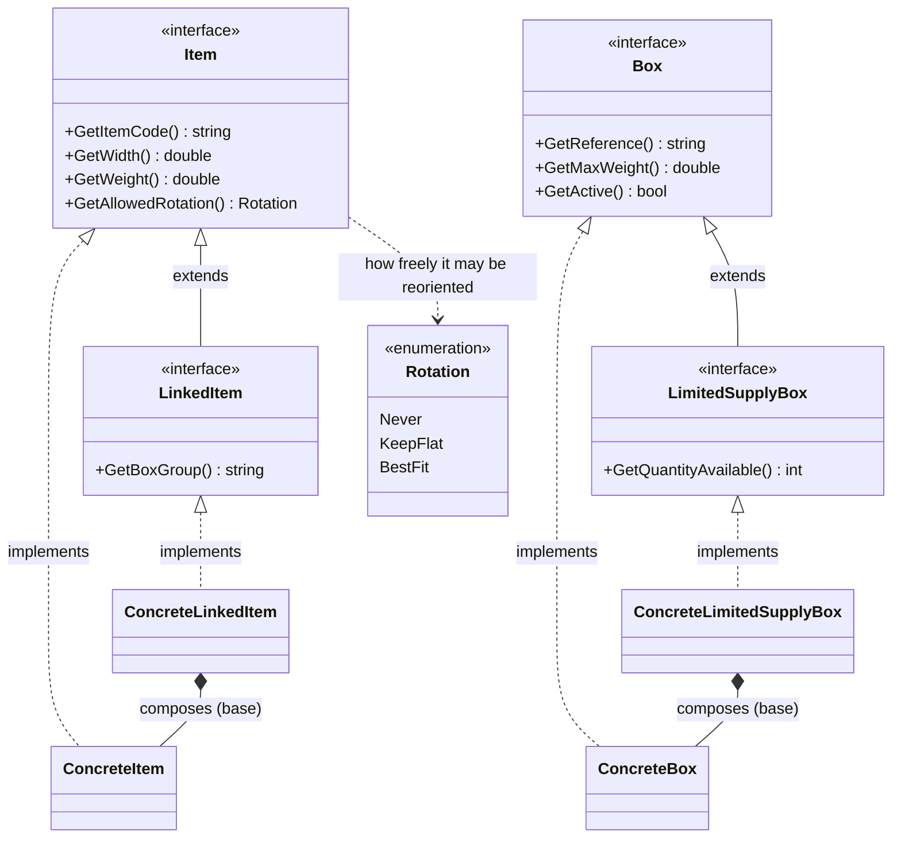
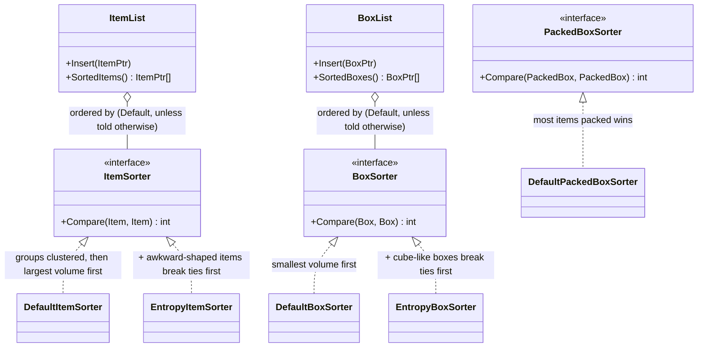
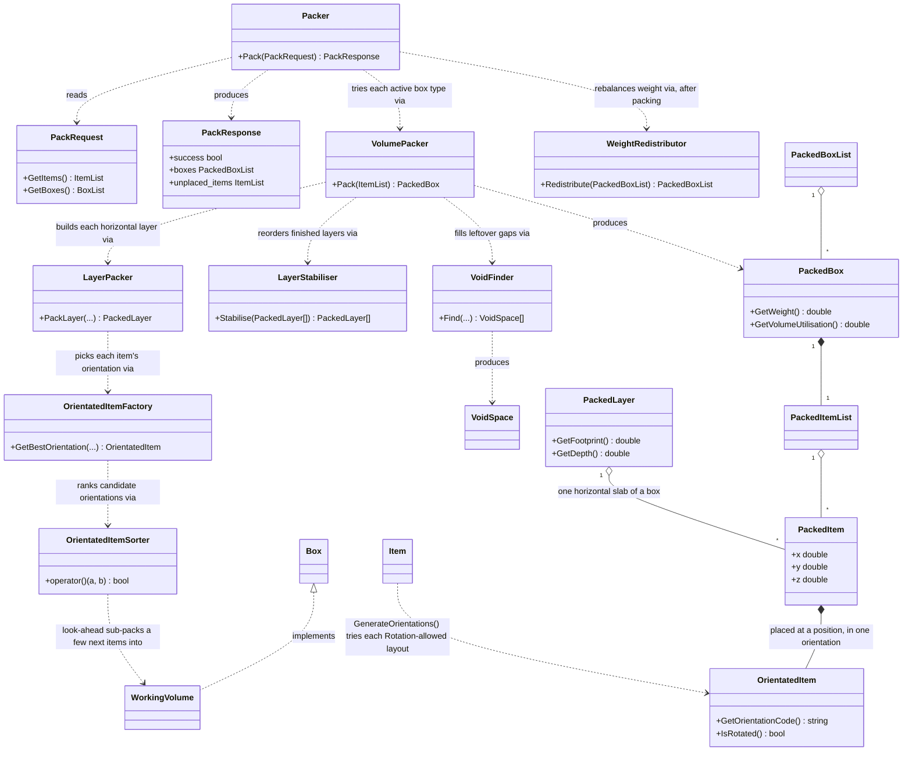
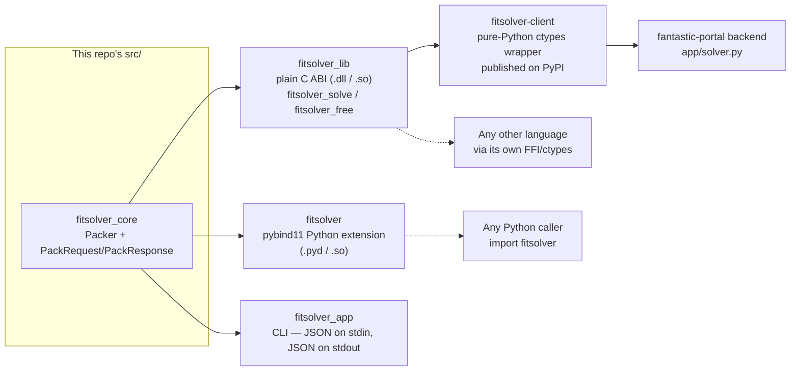

# FitSolver

A 3D bin-packing ("fit as many items into as few boxes as possible")
engine written in C++, exposed to Python as a native extension module
(`import fitsolver`) so other services/teams can call it without knowing
any C++. Also ships as a plain C ABI (for non-Python callers) and a CLI.
Wired up with CMake + Google Test + GitHub Actions CI, and a Docker/dev
container setup so nobody has to hand-install a C++ toolchain.

## What's included

```
CMakeLists.txt              # Root build config; fetches GoogleTest + pybind11
src/
  Item.h / LinkedItem.h        # Item interfaces -- implement your own, or use:
  ConcreteItem.h / .cpp        #   ConcreteItem / ConcreteLinkedItem (ready-made)
  Box.h / LimitedSupplyBox.h   # Box interfaces -- implement your own, or use:
  ConcreteBox.h / .cpp         #   ConcreteBox / ConcreteLimitedSupplyBox (ready-made)
  ItemSorter.h, DefaultItemSorter.h/.cpp   # Pluggable item packing-priority order
  BoxSorter.h, DefaultBoxSorter.h/.cpp     # Pluggable box try-order
  PackedBoxSorter.h, DefaultPackedBoxSorter.h/.cpp  # Pluggable "which box is better"
  ItemList.h/.cpp, BoxList.h/.cpp          # Ordered collections (the main way
                                             #   items/boxes are passed around)
  OrientatedItem.h/.cpp        # One candidate rotation of an item
  PackedItem.h/.cpp            # An item placed at a position, in an orientation
  PackedItemList.h/.cpp        # Items packed into one box
  PackedBox.h/.cpp             # A box + everything packed into it
  PackedBoxList.h/.cpp         # All boxes used by one packing run
  VoidSpace.h/.cpp, VoidFinder.h/.cpp  # Finds leftover rectangular gaps in a box
  WorkingVolume.h/.cpp         # A Box representing one such gap, for sub-packing
  PackedLayer.h/.cpp            # One horizontal slab of a box's packing
  LayerStabiliser.h/.cpp        # Reorders layers so nothing overhangs thin air
  PackQueue.h                   # Priority work queue for one packing attempt
  OrientatedItemFactory.h/.cpp  # Which orientation(s) of an item fit a space
  OrientatedItemSorter.h/.cpp   # Ranks candidate orientations (incl. look-ahead)
  LayerPacker.h/.cpp            # Fills one layer: shelf row, then stack/gap-fill
  VolumePacker.h/.cpp          # Packs items into ONE box instance
  WeightRedistributor.h/.cpp   # Post-pass: evens out weight between boxes used
  Packer.h/.cpp                # Top-level entry point: fitsolver::Packer().Pack(...)
  PackRequest.h/.cpp, PackResponse.h/.cpp  # Request/response + JSON (de)serialisation
  Rotation.h/.cpp               # Never / KeepFlat / BestFit
  JsonUtil.h                    # Small internal JSON-parsing helpers
  pymodule.cpp                  # Python bindings -- builds the `fitsolver` module
  abi.h / abi.cpp                # Plain C ABI (fitsolver_solve/fitsolver_free)
  main.cpp                       # fitsolver_app CLI: reads a JSON request, prints JSON
tests/
  unit/                       # Focused GoogleTest coverage by component
  integration/                # End-to-end C++ and Python binding tests
  fuzz/                       # libFuzzer target and permanent seed corpus
  fixtures/                   # Sample JSON data used by tests/examples
  manual/                     # Standalone samples and manual test placeholders
  TEST_GUIDE.md               # Behaviour documented by the GoogleTest suite
example/
  simple_solve.py             # Easiest Python usage: JSON in, JSON out
  rich_api_example.py         # Feature-rich Python usage: real objects/attributes
  python_example.py           # Calling the C ABI directly via ctypes (no pybind11)
.github/workflows/ci.yml    # CI: build + test on every push/PR
.github/workflows/cd.yml    # CD: build + push Docker image to GHCR on merge to main
Dockerfile                  # Production image (slim, deployment)
Dockerfile.dev              # Dev environment image (full build/debug tools)
docker-compose.yml          # One-command way to spin up the dev environment
.devcontainer/               # VS Code "Reopen in Container" config
```
Third-party: nlohmann/json

All JSON (de)serialisation in the C++ core — PackRequest, PackResponse, Item/Box and their Concrete* implementations — is done with nlohmann/json, specifically v3.11.3.

It's vendored, not fetched. Unlike GoogleTest and pybind11 (which CMake downloads at configure time via FetchContent — see "Notes" below), nlohmann/json ships directly in the repo as a single header:

third_party/nlohmann/json.hpp

That means: no network access needed to build, no separate install step, nothing to add to the Dockerfile or dev container for it — it's just part of the source tree like any other header. If you ever need to upgrade it, replace that one file with a newer release's single-header amalgamation and update the version noted above.

It's wired into the build as a header-only INTERFACE library in the root CMakeLists.txt:

cmake
add_library(nlohmann_json INTERFACE)
target_include_directories(nlohmann_json INTERFACE ${CMAKE_SOURCE_DIR}/third_party)

fitsolver_core links against it PUBLIC, so every target built on top of it — fitsolver_app, fitsolver_lib, fitsolver_tests, the fitsolver Python module — gets #include <nlohmann/json.hpp> for free, with no per-target setup.

Usage pattern. Every serialisable type exposes a ToJson() method returning nlohmann::json; parent objects build up their JSON by assigning into a nlohmann::json and nesting child objects' own ToJson() calls, e.g. PackResponse::ToJson() in src/PackResponse.cpp:

cpp
nlohmann::json PackResponse::ToJson() const {
  nlohmann::json j;
  j["success"] = success;

  nlohmann::json boxes_json = nlohmann::json::array();
  for (const auto& box : boxes) {
    nlohmann::json box_json = box.ToJson();   // Box has its own ToJson()
    box_json["box_index"] = box_index;
    boxes_json.push_back(box_json);
    // ...
  }
  j["boxes"] = std::move(boxes_json);
  return j;
}

PackResponse::Dump(int indent) wraps this with .dump(indent) for a printable string — that's what fitsolver_app writes to stdout and what fitsolver.solve() returns to Python. See "Request / response JSON schema" below for the actual shape this produces.

The other direction — JSON in — follows the same shape in reverse. PackRequest exposes a static FromJson(const nlohmann::json&) that builds each collection from its corresponding array key, delegating each element to a MakeItemFromJson / MakeBoxFromJson helper (see ConcreteItem.h / ConcreteBox.h) rather than parsing fields inline, so per-item/per-box parsing logic stays in one place next to the type it constructs:

cpp
PackRequest PackRequest::FromJson(const nlohmann::json& j) {
  ItemList items;
  if (j.contains("items")) {
    for (const auto& item_json : j.at("items")) items.Insert(MakeItemFromJson(item_json));
  }

  BoxList boxes;
  if (j.contains("boxes")) {
    for (const auto& box_json : j.at("boxes")) boxes.Insert(MakeBoxFromJson(box_json));
  }

  return PackRequest(std::move(items), std::move(boxes));
}

j.contains(...) guards both keys, so a request with an empty/missing items or boxes array parses to an empty list rather than throwing — worth knowing if you're debugging a PackRequest that silently packed nothing. PackRequest::FromJsonString(const std::string&) is the convenience entry point most callers actually use — it just wraps nlohmann::json::parse() around FromJson(), and is what main.cpp and abi.cpp call after reading a request off stdin / across the C ABI.

## Architecture

Four diagrams, each answering one question: what are the core types
(data model), how do you change packing behaviour without touching the
algorithm (sorting strategies), how does a request actually become
boxes (packing engine), and how does anything *outside* this repo get
to any of it (the library boundary). Short version: `Item`/`Box` are
interfaces (implement your own, or use the ready-made `Concrete*`
versions), `ItemList`/`BoxList` are how items and boxes get passed
around and ordered, `Packer` is the one entry point that ties the
algorithm together, and everything external goes through `fitsolver_lib`
(C ABI), `fitsolver` (the Python extension), or `fitsolver_app` (the
CLI) -- never the C++ classes directly.

### 1. Data model: what an Item and a Box are



`LinkedItem` and `LimitedSupplyBox` are *optional* capabilities layered
on top of the base interface -- a plain `ConcreteItem` is not a
`LinkedItem`, so `dynamic_cast<const LinkedItem*>(item.get())` is how
the rest of the codebase checks "does this particular item carry a
BoxGroup?" without every `Item` needing to carry that field. Adding a
new capability later (e.g. a fragile/this-way-up item) means adding one
new interface + one dynamic_cast check, not touching any class above.
Note `LinkedItem` is a *segregation* constraint, not a togetherness
one: `Packer` (diagram 3) keeps two different `BoxGroup`s from ever
sharing one box, but a single group's units are free to spread across
as many boxes as it takes.

### 2. Sorting strategies: swap packing *behaviour* without touching the algorithm



Every sorter is a one-method interface, and `ItemList`/`BoxList` take
one as a constructor argument -- that's the whole extension point. The
`Entropy*` sorters are a drop-in **alternative** to the `Default*`
ones (pass one to the constructor to opt in); nothing in this codebase
uses them by default. Changing how items get prioritised, or which box
gets tried first, never means touching `Packer` or `VolumePacker`.

### 3. Packing engine: how a request actually gets turned into boxes



`Packer` never touches geometry directly -- each round it just asks
`VolumePacker` "how much of what's left fits in a fresh one of these?"
for every active box type, keeps whichever answer is best (most items,
ties broken by utilisation, then used volume), and repeats until nothing
more fits. `VolumePacker` is a faithful port of BoxPacker's real
layer-packing engine: it builds up horizontal `PackedLayer`s one at a
time via `LayerPacker` (which fills a shelf row, recursively stacks a
shorter item's leftover headroom, and recursively fills the lengthwise
gap behind it), picking each item's orientation via
`OrientatedItemFactory`/`OrientatedItemSorter` (a bounded look-ahead that
sub-packs a few of the next items into a scratch `WorkingVolume` to see
which choice leaves more room), then straightens the result with
`LayerStabiliser` (reorders whole layers so the biggest footprint ends
up at the bottom) and tops it off with `VoidFinder` filling whatever
rectangular gaps remain. It also tries the box both ways round and every
orientation of the very first item, keeping whichever attempt packs the
most. See "How the algorithm works" below for the full walkthrough.

### 4. The library boundary: how anything outside `src/` calls this



Nothing outside `src/` ever touches a C++ class from the first three
diagrams directly -- every consumer goes through one of exactly three
doors, all built from the same `fitsolver_core`, all sharing the same
JSON request/response contract (see below). The portal doesn't even use
the Python extension: it depends on **`fitsolver-client`**, a small
pure-Python package with no C++ toolchain to install (its wheel vendors
the compiled `fitsolver_lib` for you) that wraps the C ABI in one call:
`fitsolver_client.solve(dict) -> dict`. See "Also included: a plain C
ABI and a CLI" and "Python bindings" below for the full detail on each
door.

## Python bindings (the `fitsolver` module)

### Build it

You need a C++17 compiler, CMake 3.18+, and a Python 3.8+ dev install
(headers + libs -- the regular python.org / Windows Store installer has
these; on Debian/Ubuntu install `python3-dev`). GoogleTest and pybind11
are fetched automatically by CMake -- nothing to install by hand for
those.

```bash
cmake -B build
cmake --build build --config Release
```

That produces, among other things, the Python module itself:

- Windows: `build/Release/fitsolver.cp3XX-win_amd64.pyd`
- Linux/macOS: `build/fitsolver.cpython-3XX-<platform>.so`

(`3XX` = whatever Python version CMake found; `--config Release` only
matters for the Visual Studio generator on Windows.)

### Run it

The Portal team just needs that one compiled file next to their script
(or on `PYTHONPATH`) -- copy it in, then:

```python
import fitsolver
```

Two quick ways to get it into place:

```bash
# Option A: copy it next to your script
cp build/Release/fitsolver.cp313-win_amd64.pyd my_project/    # Windows example
cp build/fitsolver.cpython-313-x86_64-linux-gnu.so my_project/ # Linux example

# Option B: point PYTHONPATH at the build output instead of copying
export PYTHONPATH="$PWD/build/Release:$PYTHONPATH"   # Windows (bash)
export PYTHONPATH="$PWD/build:$PYTHONPATH"           # Linux/macOS
```

Then run the examples (from the repo root, so the relative `tests/fixtures/*.json`
paths resolve, or after copying the module into your own project):

```bash
python example/simple_solve.py       # simplest: JSON in, JSON out
python example/rich_api_example.py   # richer: real objects, .weight, .orientation, etc.
python example/python_example.py     # alternative: ctypes against the C ABI, no pybind11
```

### The three ways to call it

**1. Simplest -- JSON in, JSON out.** No `fitsolver` types to learn:

```python
import json, fitsolver

request = {"items": items, "boxes": boxes}  # see schema below
response = json.loads(fitsolver.solve(json.dumps(request)))
```

**2. Rich objects from plain dicts.** Same input shape, but you get back
real Python objects with attributes for every computed feature instead of
a JSON blob to parse:

```python
result = fitsolver.pack_dicts(items, boxes)   # items/boxes: list[dict]

result.success                 # bool
result.overall_volume_utilisation
for box in result.boxes:
    box.weight                 # empty weight + everything inside
    box.max_weight
    box.remaining_weight
    box.volume_utilisation     # percent used
    box.remaining_width / box.remaining_length / box.remaining_depth
    for item in box.items:
        item.x, item.y, item.z         # placed position
        item.width, item.length, item.depth  # placed (post-rotation) size
        item.orientation                # e.g. "WLD", "DWL" -- which axes were swapped
        item.rotated                    # bool
        item.item.item_code             # back-reference to the original input item

for item in result.unplaced_items:
    ...                          # items that didn't fit anywhere

result.to_dict()   # ...or just get the JSON-shaped dict if you want it after all
result.to_json()
```

**3. Rich objects built directly in Python**, if you'd rather construct
`fitsolver.Item(...)` / `fitsolver.Box(...)` than build dicts:

```python
item = fitsolver.Item("SKU-1", "Widget", width=100, length=200, depth=50, weight=1.0)
box = fitsolver.Box("SML", width=300, length=300, depth=300, max_weight=10.0)
result = fitsolver.pack([item], [box])
```

Every bound type (`Item`, `Box`, `PackedItem`, `PackedBox`, `PackResult`)
has a matching set of read-only attributes covering everything the C++
core computes -- see `src/pymodule.cpp` for the full list, or just
`dir(obj)` / `help(fitsolver)` in a REPL.

### Request / response JSON schema

Request:

```json
{
  "items": [
    {"ItemCode": "ITM-001", "ItemReference": "Widget A", "Width": 100, "Length": 200,
     "Depth": 50, "Weight": 1.0, "BoxGroup": "GROUP-A", "AllowedRotation": "BestFit"}
  ],
  "boxes": [
    {"Reference": "SML", "Width": 150, "Length": 150, "Depth": 150,
     "MaxWeight": 8.5, "BoxWeight": 0.5, "Active": true, "MaximumBoxes": 100}
  ]
}
```

`BoxGroup` and `AllowedRotation` are optional on items (defaults: no
group, `"BestFit"` rotation). `BoxWeight`, `Active`, and `MaximumBoxes`
are optional on boxes (defaults: 0 empty weight, active, unlimited
quantity) -- but every box **must** include `MaxWeight`; there's no
"unlimited weight" box, so a request with a box missing `MaxWeight` is
rejected. `AllowedRotation` is one of `"Never"`, `"KeepFlat"`, `"BestFit"`.
`ItemCode` must be unique across the request.

`MaxWeight` is the box's **gross** limit -- what it may weigh once
filled, box included -- matching BoxPacker's `Box::getMaxWeight()`. The
weight available for contents is therefore `MaxWeight - BoxWeight`. If
you are transcribing a supplier's table that quotes a *contents* limit
instead, add the box's own weight to it first; getting this backwards
silently shrinks every box by its own tare.

A non-empty `BoxGroup` means "never share a box with a *different*
group". A single group's items are free to spread across as many boxes
as they need, and ungrouped items are compatible with any group -- so a
box holds at most one distinct group, plus any ungrouped items.

Response (`fitsolver.solve()` / `.to_json()` / `.to_dict()`):

```json
{
  "success": true,
  "boxes": [ { "box_reference": "...", "weight": ..., "volume_utilisation": ..., "items": [...] } ],
  "placements": [ { "ItemCode": "...", "x": ..., "y": ..., "z": ..., "orientation": "...", "box_reference": "..." } ],
  "unplaced_items": [ ... ],
  "unplaced_item_codes": [ "..." ],
  "summary": { "box_count": ..., "total_placed": ..., "total_unplaced": ..., "overall_volume_utilisation": ... }
}
```

`placements` is a flat list across all boxes (handy if you just want
"where did everything end up" without walking the `boxes` tree).

### How the algorithm works (and its limits)

The engine is split into cooperating classes, each in its own file under
`src/`, mirroring the DVDoug/BoxPacker PHP library's design:

- **`Packer`** is the entry point. It repeatedly picks, from the active
  box types (a `BoxList`), the single box instance that fits the most of
  what's still unplaced (a `ItemList`) -- ties broken by volume
  utilisation, then used volume -- via `VolumePacker`, and repeats until
  nothing more fits. A `BoxGroup` (`LinkedItem`) only means "don't mix
  with a *different* group" -- a box may not end up holding two or more
  distinct groups together, but a single group is free to spread across
  as many boxes as it takes, same as ungrouped items; if a candidate box
  ends up with more than one group present, only the best-represented
  one (plus every ungrouped item, always compatible) is kept, and the
  rest are pulled back out for another box to pick up. When a request
  carries two or more groups, which items share a pass matters a lot, so
  `Packer` also tries -- for each of the (up to 4) largest groups --
  packing the ungrouped items together with that group, then every other
  group on its own, and keeps whichever strategy places the most items in
  the fewest boxes (ties keep the single pass, so requests these
  strategies don't improve pack exactly as before). Box quantity limits
  carry across a strategy's passes. If more than one box ends up used,
  `WeightRedistributor` runs afterwards to move items between boxes where
  that reduces weight variance without changing the box count. A move
  can repack a box into a different box type, so it tracks each type's
  remaining supply and never picks one whose `MaximumBoxes` is used up.
- **`VolumePacker`** packs one box instance -- a faithful port of
  BoxPacker's real layer-packing engine, not a simple shelf scan. It
  builds up horizontal `PackedLayer`s one at a time via `LayerPacker`:
  each layer fills a shelf row left-to-right, recursively stacks a
  shorter item's spare headroom with more items, and recursively fills
  the lengthwise gap left behind a short item next to a taller one.
  Every item's orientation is chosen by `OrientatedItemFactory` /
  `OrientatedItemSorter` -- preferring an exact fit, then (for a run of
  identical items) whichever orientation tiles the most of them on a
  grid, then a bounded look-ahead that sub-packs a few of the next items
  into a scratch region to see which choice leaves more usable space.
  Once every item that fits is placed, `LayerStabiliser` reorders the
  whole layers by descending footprint (so nothing ends up overhanging
  thin air) and `VoidFinder` fills whatever rectangular gaps remain
  (via `WorkingVolume`, a `Box` implementation representing just that
  gap). The box is tried both its natural way round and with
  width/length swapped, and every valid orientation of the single
  highest-priority item is tried as the starting placement -- keeping
  whichever full attempt packs the most, best utilisation breaking ties.

This is a solid heuristic port, not an exhaustive/optimal packer --
`tests/integration/packer_test.cpp` documents the behaviour it guarantees (no
overlaps, weight limits respected, rotation rules respected, box groups
never mixed). It does not implement exhaustive all-permutations search
across box choices; that would be a reasonable follow-up if the result
isn't good enough for a given item set.

### Time complexity

Let `n` be the number of physical items in the request, `b` the number of
active box types, and `m` the number of boxes the solution actually ends up
using (`m <= n`, but in practice `m` is small).

- **One placement** (`OrientatedItemFactory::GetBestOrientation`) is O(1):
  at most 6 candidate orientations are generated and sorted, and the
  bounded look-ahead each comparison can trigger
  (`OrientatedItemSorter::CalculateAdditionalItemsPacked`) sub-packs at
  most 7 upcoming items in a mode that disables any further recursive
  look-ahead, so it never nests. Repeated look-ahead situations (same
  remaining space, same upcoming items) are memoised in a thread-local
  cache, making genuinely repeated placements (e.g. a long run of
  identical items) O(1) with a very small constant; distinct geometry on
  every placement still costs only the same bounded constant, never more.
- **One `VolumePacker::Pack()` call** (fit as much as possible into one
  fresh box) is O(n) typically: `LayerPacker` pulls items off a queue,
  placing each in O(1) or deferring it to the next shelf row. Worst case
  is O(n²) -- an adversarial item mix where nothing shares a row forces a
  full rescan of what's left on every wrap to a new row.
- **`Packer::Pack()` as a whole** is **O(m · b · n²) worst case**, O(m · b ·
  n) typical: its outer loop runs once per box actually used (`m` times),
  and each time re-tries every active box type (`b`) via a fresh
  `VolumePacker::Pack()` over whatever's still unplaced.
- **Box-group strategies** (requests with `g >= 2` box groups only) repeat
  that whole packing up to `min(g, 4)` more times, so they multiply it by a
  constant of at most 5, never by `n`. Two more bounds keep that extra work
  cheap: a strategy is abandoned the moment it has used as many boxes as
  the best result so far with items still left over, and the strategies
  between them may make at most **3x as many single-box packing attempts
  as the single pass did** -- so the extra time is at most ~3x the single
  pass's. That budget is counted in work, not wall-clock time, on
  purpose: an earlier time-based budget let a busy machine cut the
  winning strategy short, so the same request could pack differently on
  different machines. The single pass always runs to completion, so these
  can only ever improve a result, never withhold one.
- **`WeightRedistributor`** only ever runs when the solution used more
  than 1 and at most 12 boxes (`Packer::kMaxBoxesToBalanceWeight`), so its
  own box count is a *constant*, independent of `n` and `m`. It rescans
  all pairs of boxes for a beneficial item move and restarts that scan
  from the top after every move it makes -- a shape shared by BoxPacker's
  own `WeightRedistributor`, whose `calculateVariance()` is the same
  pair-relative-to-its-own-mean formula ours uses, not relative to the
  request's overall target. That is not a globally monotone measure:
  two boxes can trade an item back and forth as the redistributor keeps
  re-pairing them against different neighbours in between, each move
  legitimately variance-reducing *for the pair it was made for* while the
  arrangement as a whole never settles. This was confirmed by
  construction, not just suspected: `benchmarks/boxpacker_comparison/`'s
  random-scenario generator produced an input where the exact same item
  object was moved from one box to another and later moved back, and nothing
  in either this port or BoxPacker's own implementation rules that out.
  Rather than an iteration cap (which just moves the question to "how
  expensive is one iteration"), this phase is bounded by a **250ms
  wall-clock deadline**, checked before every repack rather than only
  between full scans (one scan over every pair can itself run many
  repacks) -- safe because weight balancing is a pure optimisation pass
  over an already-complete, already-valid packing, so stopping partway
  through can only leave boxes somewhat less evenly loaded, never break
  correctness.
- **Overall**: **O(m · b · n²)** worst case. The redistribution deadline
  and the group-strategy work budget are what keep the extra phases from
  adding anything unbounded on top of the core packing -- see the next
  section for the measured numbers this produces in practice.

### Benchmark: solve time and box count vs. dvdoug/boxpacker

`benchmarks/boxpacker_comparison/` generates 1000 random packing requests
and runs each through both this engine and dvdoug/boxpacker 4.3 (the PHP
reference this port is modelled on), to check two things: that this engine
is faster on average, and that it never takes a box count dvdoug/boxpacker
wouldn't also reach. See that directory's own README for how to regenerate
and re-run it. Latest run (seed 1337, 1000 scenarios, ~60,600 item units
total; each scenario timed best-of-3 on both sides -- see that README's
"Timing method"):

|                              | fitsolver (this repo) | dvdoug/boxpacker 4.3 |
|------------------------------|-----------------------:|----------------------:|
| Average solve time           |               28.8 ms |               85.3 ms |
| Median solve time            |               12.4 ms |               32.2 ms |
| Worst solve time             |              360.9 ms |             2605.4 ms |
| Scenarios over 1s            |                0/1000 |                9/1000 |
| Scenarios over a box limit   |                0/1000 |                0/1000 |

fitsolver is faster on every measure above, and -- because of the
redistribution deadline described in "Time complexity" -- never comes
close to the 1-second mark even in its worst case, where dvdoug/boxpacker
(which has no such deadline applied in this comparison) occasionally does.
The box-limit row is there because a result that overspends a box type's
`MaximumBoxes` can "win" on box count: before `WeightRedistributor`
tracked remaining supply, fitsolver did exactly that on one of these
scenarios.

Box count is a more mixed result, worth reporting honestly rather than
rounding up: fitsolver matched dvdoug/boxpacker's box count on 871/1000
scenarios and used *fewer* boxes on 81/1000, but used *more* boxes on
48/1000 (typically by 1-2 boxes; the worst case used 6 more). These
scenarios carry no box groups, so the box-group strategies don't apply;
the gap is greedy layer-packing myopia that BoxPacker's own algorithm
shares (on the Chaotic fixture with groups stripped, it's BoxPacker that
comes out behind: 73 boxes to fitsolver's 70). Closing it fully would mean
moving past a single greedy pass (e.g. backtracking across box-type
choices, or an exact solver for small item counts) rather than a targeted
fix, and hasn't been attempted here.

### Benchmark: the Thommeax scenarios

`tests/ThommeaxMinimumTests/` holds three scenarios with a reference
result each; `thommeax_benchmark_test.cpp` asserts every unit is placed in
no more boxes than the reference, within every box type's
`MaximumBoxes`, and (Chaotic) without mixing box groups:

| Scenario      | Units | Reference boxes | fitsolver | dvdoug/boxpacker 4.3 |
|---------------|------:|----------------:|----------:|----------------------:|
| Simple        |     3 |               2 |         2 | 1 |
| SemiRealistic |   115 |               4 |         4 | 4 |
| Chaotic       |   300 |              67 |        65 | 62 (two-pass); 48 units unplaced in one pass |

dvdoug/boxpacker's Chaotic figures come from
`benchmarks/boxpacker_comparison/php/run_thommeax.php`. Its `LinkedItem`
means "the whole group in one box", which no box here can hold, so a
single pass can't place either group; packed the way the reference was
(ungrouped items with FOOD, then CORROSIVE alone) it reaches 62.

### Extending it

Every extension point BoxPacker itself supports is available here the
same way:

- **A custom item type**: implement `Item` directly (or `LinkedItem` if
  it needs the box-group constraint) instead of using `ConcreteItem` --
  anywhere in the codebase that needs to check for a capability does it
  via `dynamic_cast<const SomeInterface*>`, so a new Item subtype is
  usable everywhere without changing existing code.
- **A custom box type**: implement `Box` or `LimitedSupplyBox` the same
  way, instead of `ConcreteBox`.
- **A different packing priority order**: implement `ItemSorter` /
  `BoxSorter` / `PackedBoxSorter` and pass it to `ItemList` / `BoxList` /
  `PackedBoxList`'s constructor instead of the `Default*Sorter`.

### Also included: a plain C ABI and a CLI

- `fitsolver_lib` (built from `src/abi.cpp`) exposes
  `fitsolver_solve(const char*) -> char*` / `fitsolver_free(void*)` --
  the same JSON-in/JSON-out contract as `fitsolver.solve()`, but callable
  from anything that can load a shared library (see
  `example/python_example.py` for a ctypes example). Use this if you
  can't build a CPython extension for some reason.
- `fitsolver_app` (built from `src/main.cpp`) is a CLI: pipe a JSON
  request in on stdin (or pass a file path as the first argument) and it
  prints the JSON response to stdout -- `fitsolver_app < request.json`.

### Running the C++ tests

```bash
cmake --build build --config Release
ctest --test-dir build -C Release --output-on-failure
```

## How it works

1. On every push and every PR into `main`, GitHub Actions spins up an
   Ubuntu runner.
2. It configures the project with CMake, builds it, then runs the test
   suite with `ctest`.
3. If the build fails or any test fails, the workflow run is marked ❌
   and (depending on your branch protection settings) the PR can't be
   merged until it's fixed.

This has been built and tested locally end-to-end (`cmake -B build`,
`cmake --build build`, `ctest --output-on-failure`) to confirm the
exact sequence the CI workflow runs actually works.

## Adding the CI badge to your README

Once the workflow has run at least once, add this to the top of your
main README (replace `ORG` and `REPO`):

```markdown

```

This renders as a live green/red badge showing the current build
status — useful evidence to show in sprint reviews.

## Notes
- `FetchContent` downloads GoogleTest fresh on first configure, so the
  very first CI run will be a little slower (subsequent runs can be
  sped up later with `actions/cache` on the `build/_deps` directory if
  build times become a problem).
- If you move to Drogon for the API layer, add `find_package(Drogon
  REQUIRED)` (after installing/fetching it) and link it into
  `fitsolver_app` the same way `fitsolver_core` is linked now. The
  Dockerfile already installs Drogon's common system dependencies
  (openssl, zlib, uuid, jsoncpp) so it won't need changes for that.

## CD — Docker image to GHCR
`.github/workflows/cd.yml` is triggered by the **CI workflow finishing
on `main`**, not by push directly — so it only ever runs against a
commit CI has actually verified (`if: ... workflow_run.conclusion ==
'success'` double-checks this even if branch protection isn't
configured to require it). It builds the `Dockerfile` and pushes the
image to **GitHub Container Registry** (`ghcr.io`) using the built-in
`GITHUB_TOKEN` — no extra secret needed. It can also be run manually
from the Actions tab (`workflow_dispatch`).

Each build is tagged two ways:
- the short commit SHA (e.g. `ghcr.io/your-org/fitsolver:a1b2c3d`) — for traceability back to an exact commit
- `latest` — always the newest successful build on `main`

**First-time setup:**
1. Push once — the workflow runs automatically the next time CI
   succeeds on `main` (e.g. after your next PR merges).
2. Go to your repo's **Packages** tab on GitHub to see the published image.
3. By default a new GHCR package is **private**. If your team wants to
   pull it without authenticating, go to the package settings and make
   it public (or use a token to pull if it stays private).

The image ships `fitsolver_app` as a one-shot CLI (see "Also included: a
plain C ABI and a CLI" above) — it reads a JSON request on stdin, prints
the JSON response, and exits; it is **not** a long-running server, so
there's no port to publish. Pull and run it locally with:
```bash
docker pull ghcr.io/YOUR-ORG/YOUR-REPO:latest
docker run --rm -i ghcr.io/YOUR-ORG/YOUR-REPO:latest < request.json
```

## Dev environment — no one has to install C++ tooling locally

Rather than everyone installing g++, CMake, and Drogon's system
libraries by hand (and hitting different bugs on Mac vs Windows vs
Linux), the repo includes a **dev container** with everything
preinstalled. Two ways to use it, same result:

### Option A — VS Code (easiest for most people)

1. Install the **Dev Containers** extension in VS Code.
2. Open the repo folder in VS Code.
3. Click **"Reopen in Container"** when prompted (or Cmd/Ctrl+Shift+P →
   "Dev Containers: Reopen in Container").
4. VS Code builds the image once, then drops you into a terminal
   inside the container with everything already installed. Edit files
   normally — your changes are on your actual disk (bind-mounted), the
   container just provides the toolchain.

### Option B — plain Docker / docker-compose (any editor, any OS)

```bash
# Build the dev image once
docker compose build

# Start it and get a shell inside
docker compose run --rm dev

# Inside the container, build and test exactly like CI does:
cmake -B build -DCMAKE_BUILD_TYPE=Release
cmake --build build
cd build && ctest --output-on-failure
```

Your local files are mounted into `/workspace` inside the container,
so anything you edit on your host is what gets built — nothing is
copied into the image. Exit the shell any time; your `build/` folder
persists on disk for the next run.

**Why this matters for a 4-person team:** whoever wrote the Dockerfile
originally already had to solve "what libraries does this need" —
everyone else just runs one command and gets the identical
environment, instead of each person separately debugging missing
`libssl-dev` or a wrong CMake version on their own machine.


Build Notes (need to make this pretty)
cd "/FantasticSolver" && cmake -B build 2>&1 | tail -10


cd "/FantasticSolver" && cmake --build build --config Release --parallel 2>&1 | tail -20 && ./build/Release/fitsolver_tests.exe