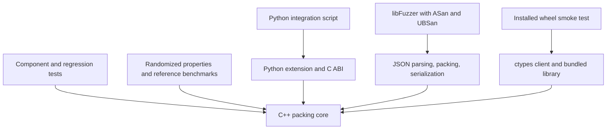

# FantasticSolver testing

Updated 16 September 2026 against this checkout's test sources, CMake configuration and GitHub Actions workflows.

## Presentation overview

Testing combines C++ component and integration tests, deterministic randomized properties, reference packing benchmarks, Python/C ABI checks, coverage-guided fuzzing with sanitizers, and installed-wheel smoke tests. Manual timing provides separate performance measurements.

**There are 124 executable GoogleTest cases in 12 C++ source files.** CTest registers one test, `fitsolver_tests`, that runs all 124 cases. The 200 randomized requests are iterations inside one case. Python checks, fuzz iterations, wheel checks and timing runs are separate from that count.

## 1. Current structure

```text
tests/
  unit/                         10 C++ files, 76 executable cases
    test_helpers.h              Shared construction helpers
  integration/
    packer_test.cpp             45 C++ cases
    thommeax_benchmark_test.cpp  3 C++ reference scenarios
    test_fitsolver.py           Python extension and C ABI assertions
  fixtures/                     items.json and boxes.json for integration
  ThommeaxMinimumTests/
    Simple/                     items.json, boxes.json, reference RESULTS.md
    SemiRealistic/               Same structure
    Chaotic/                     Same structure
  fuzz/
    fuzz_pack_request.cpp       libFuzzer entry point
    corpus/                     Four committed JSON seeds
  manual/
    timed_test.cpp              Explicit CMake timing target
    test_solver.cpp             Standalone usage sample
    system_test.cpp             Empty placeholder
  TEST_GUIDE.md                 Link to this guide
```

Directory names are organizational: `packer_test.cpp` also contains component regressions, while `entropy_test.cpp` includes integration checks. The C++ tests link the real `fitsolver_core`; this is not a mock-based suite.



## 2. C++ test inventory

Paths in this table are relative to `tests/`.

| Source | Cases | Main checks |
|---|---:|---|
| `unit/box_classes_test.cpp` | 4 | Capacity, JSON, limited quantity, sorting and lists. |
| `unit/item_classes_test.cpp` | 8 | Plain/linked items, factory, sorting, cache invalidation, identity removal, duplicate codes and group counts. |
| `unit/packed_classes_test.cpp` | 5 | Offsets, totals, utilization, candidate ranking and weight statistics. |
| `unit/request_classes_test.cpp` | 2 | Request parsing and placed/unplaced totals. |
| `unit/packing_classes_test.cpp` | 17 | Working volume, redistribution stability, empty/exact fit, tare, weight, rotation, rows/layers, duplicate identities and repeated packing. |
| `unit/rotation_test.cpp` | 7 | String/enum conversion, casing, underscore alias and fallback. |
| `unit/orientateditem_test.cpp` | 4 | Rotation policies, preserved volume and source identity. |
| `unit/voidspace_test.cpp` | 6 | Origin, dimensions, volume, footprint and zero width. |
| `unit/voidfinder_test.cpp` | 5 | Empty/full boxes, residual spaces, interior splitting and nonintersecting subtraction. |
| `unit/entropy_test.cpp` | 18 | Shannon/shape entropy, sorter priorities and packing with entropy sorters. |
| `integration/packer_test.cpp` | 45 | Packing rules, detailed model/result checks, support boundaries, regressions and random invariants. |
| `integration/thommeax_benchmark_test.cpp` | 3 | Simple, SemiRealistic and Chaotic scenarios. |
| **Total** | **124** | **76 under unit; 48 C++ cases under integration.** |

The 17 packing-class cases comprise 11 ordinary tests plus two parameterized tests run with three rotation policies: 11 + (2 x 3). Counting `TEST` declarations alone misses the expanded cases.

### Important rules and boundaries

- Fitting items are placed; oversized/overweight items remain unplaced. Inactive boxes and limited box supply are checked.
- Smallest-suitable-box examples check selection behavior, but do not prove globally optimal packing.
- Never allows one orientation, KeepFlat allows two footprint permutations, and BestFit allows six axis permutations.
- Different nonempty box groups cannot share a box. One group's units **may span multiple boxes**. `LinkedItemsStayInTheSameBox` checks a particular fitting example, not a universal one-box-per-group rule.
- Item weight capacity is `MaxWeight - BoxWeight`. Exact equality is accepted. JSON boxes require `MaxWeight`; direct C++ construction also supports unlimited-capacity cases.
- Elevated placements require at least 75% footprint support. Tests accept 75%, reject 74.99%, exercise above-floor support and check bottom-up placement ordering. This geometric rule does not simulate load-bearing strength or physical stability.
- Identity checks distinguish separate items even when codes match. Other checks cover list cache invalidation, serialization, accounting, remaining space and utilization.
- Entropy checks cover uniform/skewed/zero distributions, scale and permutation invariance, and volume-first sorting with shape tie-breakers. They do not prove that entropy sorting always improves packing.

### Deterministic randomized property test

`PackerPropertyTest.RandomRequestsPreserveAccountingBoundsAndWeight` uses `std::mt19937` seeded with `0xB0C5`. It generates 200 requests with 0-25 items, dimensions from 1-40 and weights from 1-10, using fixed small and large box types.

It checks general invariants instead of requiring a particular arrangement:

1. Placed plus unplaced counts equal the input count.
2. Every input object appears once across placed and unplaced results.
3. Coordinates are nonnegative and items stay inside their boxes.
4. Each pair of placements is separated along at least one axis, preventing overlap.
5. Gross box weight stays within its limit.

The fixed seed supports repeatable debugging within the same toolchain. This bounded generator is not exhaustive; it does not check support or group segregation on every random request. Dedicated cases cover those rules.

## 3. Reference packing benchmarks

The fixture `RESULTS.md` files record reference output from dvdoug/boxpacker 4.3 on PHP 8.4. They are reference targets, not fresh measurements from this solver. The C++ tests hard-code these thresholds rather than parsing the Markdown at runtime.

| Scenario | Required physical units placed | Maximum boxes |
|---|---:|---:|
| Simple | 3 | 2 |
| SemiRealistic | 115 | 4 |
| Chaotic | 300 | 67 |

The harness expands catalogue `Quantity` into individual units with unique codes ending in `::0`, `::1`, etc. It removes boxes missing a non-null `MaxWeight` before constructing the request. Assertions check success, no unplaced units, expected count, exact multiset equality of expected and placed codes, and the box-count ceiling. This prevents a result passing by dropping or duplicating units.

**Current known failure:** the local run for this update placed 293/300 Chaotic units, leaving seven unplaced. Source comments identify three GLASS and two LEAD units affected by the reference's apparent contents-only weight interpretation, and two ANVIL units affected by greedy consumption of scarce box types. The run confirms the count; that causal explanation comes from the source comments, not a new investigation.

Chaotic is enabled and still requires all 300 units; it is neither skipped nor marked as an expected failure. Its failure fails the CTest suite and CI. These scenarios measure packing quality against reference examples, not runtime or mathematical optimality.

## 4. Python extension and C ABI integration

`tests/integration/test_fitsolver.py` is a directly executed assertion script, not a pytest suite or CTest entry. Do not use `python -O`, which disables its assertions. It searches for native artifacts in `build/`, `build/Release/` and `build/Debug/`.

| Interface | Checks |
|---|---|
| C ABI through ctypes | Empty request, malformed JSON error response, null input as an empty request, freeing each returned allocation with `fitsolver_free`. |
| Python JSON API (`solve`) | Fixture response fields/code accounting and an exact dimension/weight fit with 100% utilization and WLD orientation. |
| Python object API (`Item`, `Box`, `pack`) | Rotation, quantity metadata, result layers, weight, coordinates and serialization. |
| Python dictionary API (`pack_dicts`) | Inactive box leaves the item unplaced. |
| Python error translation | Malformed JSON raises an exception. |

The fixture accounting uses sets of codes, which cannot alone detect duplicate multiplicity. C++ identity assertions and benchmark multisets provide stronger accounting in their respective cases. The C ABI checks are smoke coverage, not exhaustive ownership or ABI validation.

The interpreter must match the extension's Python version and platform. An import failure can be an environment mismatch rather than a failing solver assertion.

## 5. Coverage-guided fuzzing

`tests/fuzz/fuzz_pack_request.cpp` sends arbitrary bytes through JSON request parsing, real packing and response serialization, then reparses the output. Expected JSON exceptions and `std::invalid_argument` are caught; unexpected exceptions, crashes and sanitizer findings can fail the process.

Four committed seeds start exploration: `empty_request.json`, `single_exact_fit.json`, `no_fit.json` and `linked_limited.json`. libFuzzer mutates inputs and uses execution coverage to explore paths, unlike the property test's fixed valid-request generator.

The opt-in `FITSOLVER_BUILD_FUZZER` CMake option requires Clang and builds a separately instrumented copy of the complete core with:

- AddressSanitizer: detects memory errors.
- UndefinedBehaviorSanitizer: detects undefined operations.
- libFuzzer instrumentation: guides input exploration.

CI uses a 60-second fuzz budget, a 65,536-byte maximum input, final statistics and a crash-artifact directory, with a three-minute workflow step timeout. The harness also rejects inputs over 64 KiB. A byte limit does not guarantee cheap processing of every valid request.

Limitations: the target does not assert placement correctness or optimality. Its JSON exception handler also encloses output reparsing, so a JSON parse exception there would be swallowed. A short clean run does not prove memory safety or exhaustive coverage.

## 6. Continuous integration and distribution checks

| Workflow | Trigger | Checks |
|---|---|---|
| `.github/workflows/ci.yml` | Every branch push; PRs targeting main | Ubuntu Release build, CTest, Python/C ABI script, separate Clang sanitizer/fuzz build and 60-second run. Uploads crash artifacts on failure when present. |
| `.github/workflows/wheels.yml` | Main pushes, v-prefixed tags, selected source/package/build/workflow PR paths, manual dispatch | Linux x86-64, macOS universal2 and Windows x64 library/wheel builds; clean-environment install and one successful `fitsolver_client.solve` request; metadata checks. |
| `.github/workflows/cd.yml` | Successful CI completion on main; manual dispatch | Container build/publish. Automatic runs use the CI-verified commit; manual dispatch bypasses the CI-success condition. No separate container runtime smoke test. |

Wheel jobs disable GoogleTest and the Python extension, and exercise the ctypes package with its bundled shared library. The macOS wheel contains both architectures, but the configured smoke test runs on ARM rather than separately testing Intel. PyPI publishing is tag-gated after wheel and source-distribution jobs succeed.

There is no configured line/branch coverage report, coverage-percentage gate, scheduled long fuzz campaign or performance regression threshold. Coverage-guided fuzzing is an input-selection technique, not a published coverage percentage.

## 7. Running the checks

Run from the repository root. Requirements: CMake 3.18+, a C++17 compiler and compatible Python development headers/libraries for the extension. Default configuration fetches GoogleTest v1.15.2 and pybind11 v3.0.4, so initial configuration needs dependency access or an existing local FetchContent cache.

### Standard build and tests

```sh
cmake -S . -B build -DCMAKE_BUILD_TYPE=Release
cmake --build build --config Release
ctest --test-dir build -C Release --output-on-failure
python tests/integration/test_fitsolver.py
```

Single-configuration generators use `CMAKE_BUILD_TYPE`; Visual Studio uses `--config Release`. Run Python separately even though CTest is only one entry: it validates different interfaces.

For core tests without Python development dependencies:

```sh
cmake -S . -B build-core -DCMAKE_BUILD_TYPE=Release -DFITSOLVER_BUILD_PYTHON=OFF
cmake --build build-core --config Release --target fitsolver_tests
ctest --test-dir build-core -C Release --output-on-failure
```

### List and isolate GoogleTest cases

```sh
./build/fitsolver_tests --gtest_list_tests
./build/fitsolver_tests --gtest_filter="ThommeaxBenchmark.*"
./build/fitsolver_tests --gtest_filter="PackerPropertyTest.*"
./build/fitsolver_tests --gtest_filter="VolumePacker.*:VolumePackerClassTest.*:RotationPolicies/*"
```

On Windows, use `./build/fitsolver_tests.exe` for single-configuration builds or `./build/Release/fitsolver_tests.exe` for Visual Studio Release. `ctest -V` displays individual case output; `ctest -N` lists the one registered suite.

### Fuzzing in a Clang/Linux environment

```sh
cmake -S . -B build-fuzz -DCMAKE_BUILD_TYPE=RelWithDebInfo -DCMAKE_CXX_COMPILER=clang++ -DFITSOLVER_BUILD_TESTS=OFF -DFITSOLVER_BUILD_PYTHON=OFF -DFITSOLVER_BUILD_FUZZER=ON
cmake --build build-fuzz --target fuzz_pack_request
mkdir -p build-fuzz/fuzz-artifacts build-fuzz/corpus
cp tests/fuzz/corpus/*.json build-fuzz/corpus/
./build-fuzz/fuzz_pack_request build-fuzz/corpus -max_total_time=60 -max_len=65536 -artifact_prefix=build-fuzz/fuzz-artifacts/ -print_final_stats=1
```

This local command copies the seeds because libFuzzer can write additional inputs into its first corpus directory. CI uses `tests/fuzz/corpus` directly. Reproduce a crash by passing the saved input file as the fuzzer argument, then add a focused regression and retain useful seeds after fixing the cause.

### Manual performance measurement

```sh
cmake -S . -B build-perf -DCMAKE_BUILD_TYPE=Release -DFITSOLVER_BUILD_TESTS=OFF -DFITSOLVER_BUILD_PYTHON=OFF
cmake --build build-perf --config Release --target fitsolver_timed_test
./build-perf/fitsolver_timed_test 100
```

Adjust the executable path for Windows as above. The positive iteration count defaults to 100. The harness checks a warm-up, then repeatedly parses its embedded request, packs, checks counts/success and serializes. It reports total time, average milliseconds, runs per second and an output-size checksum. This is in-process timing; it excludes CLI startup and Python calls. It is excluded from the default build and CTest, with no speed threshold. Compare Release runs on consistent hardware and input.

`test_solver.cpp` is a standalone sample, not a registered test. `system_test.cpp` is empty; do not count it as system-test coverage.

## 8. Verification and honest presentation claims

Local verification on 16 September 2026 used the existing Windows MinGW Debug build:

- Rebuilt `fitsolver_tests`, the Python extension and `fitsolver_lib` successfully.
- CTest ran 124 cases from 44 GoogleTest suites: **123 passed; Chaotic failed**, with 293 placed and seven unplaced. CTest consequently reports its single entry as failed.
- Python/C ABI integration passed using the CMake-configured Python 3.11 interpreter and adding the MinGW runtime directory to the process DLL search path. Initial attempts exposed a PATH Python 3.12 mismatch and missing DLL discovery, rather than solver assertion failures.

The successful command for this Windows checkout was:

```powershell
& 'C:/Users/lemar/AppData/Local/Programs/Python/Python311/python.exe' -c "import os, runpy; dll_dir = os.add_dll_directory('C:/msys64/ucrt64/bin'); runpy.run_path('tests/integration/test_fitsolver.py', run_name='__main__')"
```

Remote CI, wheel packaging, fuzzing and timing results are not claimed by this local documentation check.

For the presentation, distinguish tested correctness from optimality, geometric support from physical stability, and source-recorded reference results from observed runs. A passing core suite alone cannot detect a broken binding or packaged-library lookup.

For new behavior, add a regression whose assertions fail under the previous behavior. Use `unit/` for component checks and `integration/` for combined scenarios; register new C++ files in `CMakeLists.txt`. Recount using `--gtest_list_tests` so parameterized cases are included, and update this guide when test registration or workflows change.
