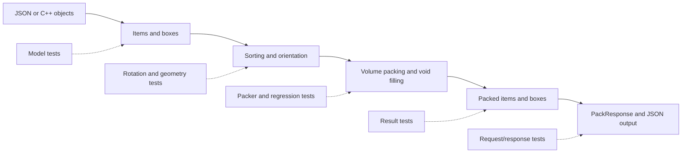
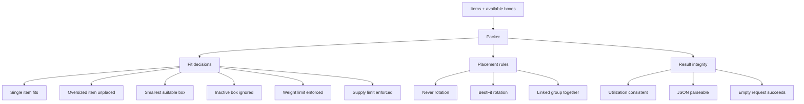
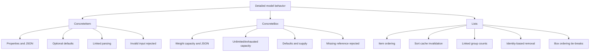
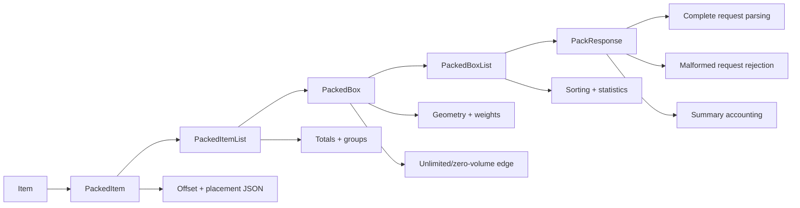
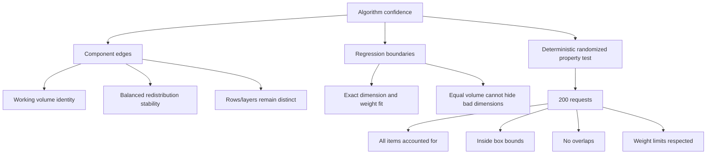
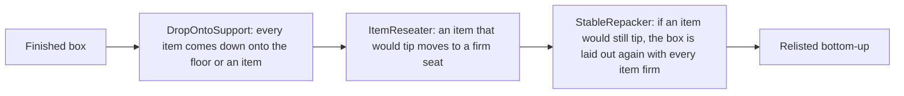
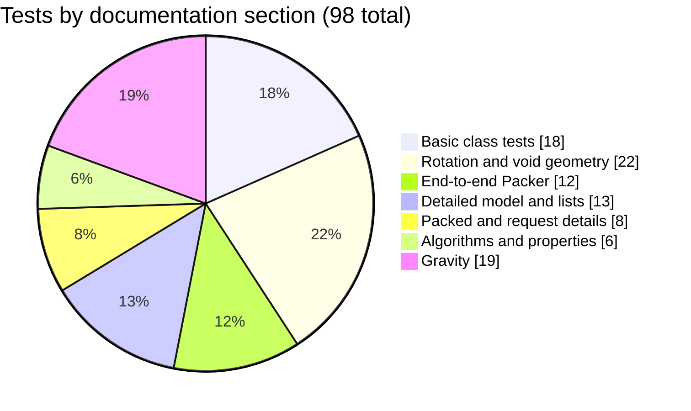

# FantasticSolver test guide

## CI timing budget

CI has a separate **Check 2 ms C++ test budget** step after the correctness,
Python binding and fuzz checks. It runs every enabled GoogleTest case, including
`ThommeaxBenchmark.Simple`, `SemiRealistic` and `Chaotic` (the complex scenario).
The job summary lists each test's median, minimum and maximum time in milliseconds,
sample count and pass/fail result. The same Markdown report is downloadable as the
`test-timings` artifact, including when the budget fails.

The timing run uses a Release build, a monotonic high-resolution clock, one full
warm-up iteration and five measured iterations in the same process. A test must
have a median **strictly below 2 ms**, and all six iterations must pass correctness.
Missing samples, skipped tests and an empty test selection fail the check.
The median reduces sensitivity to occasional scheduling delays; this is not a
guarantee that every invocation finishes in 2 ms.

This measures each complete C++ test, including per-test setup/teardown, fixture
loading, parsing and assertions. Process startup and suite-level setup are excluded.
A test that solves 100 requests is measured as one complete test, not divided by
100. Python tests, fuzzing and the separate PHP comparison benchmark are not subject
to this budget. The target is intentionally enforced even if the current baseline
exceeds it; enabling the check does not make the solver faster.

To reproduce in PowerShell (use a fresh Release build directory):

```powershell
cmake -S . -B build-timing -DCMAKE_BUILD_TYPE=Release -DFITSOLVER_BUILD_PYTHON=OFF
cmake --build build-timing --config Release --target fitsolver_tests
$env:FITSOLVER_TIMING_REPORT = "$PWD/build-timing/test-timings.md"
try {
    # For Visual Studio generators use build-timing/Release/fitsolver_tests.exe.
    ./build-timing/fitsolver_tests.exe --gtest_brief=1
} finally {
    Remove-Item Env:FITSOLVER_TIMING_REPORT
}
```

On Linux/macOS:

```bash
FITSOLVER_TIMING_REPORT=build/test-timings.md ./build/fitsolver_tests --gtest_brief=1
```

Without `FITSOLVER_TIMING_REPORT`, the executable and CTest run the normal
correctness suite once, without enforcing a performance budget. A GoogleTest
filter can be used for local investigation; CI intentionally runs the full suite.

## Coverage reference

This document describes 98 of the GoogleTest cases registered in `fitsolver_tests`.
The diagrams show how the tests divide the solver into layers; the tables explain
the exact behavior checked by every test.

## How the suite exercises the solver



## 1. Basic class tests (18 tests)

```mermaid
flowchart TB
    ROOT["Basic public-class behavior"]
    ROOT --> ITEMS["Item classes"]
    ITEMS --> I1["Concrete and linked data"]
    ITEMS --> I2["JSON item factory"]
    ITEMS --> I3["Item sorting"]
    ITEMS --> I4["ItemList operations"]

    ROOT --> BOXES["Box classes"]
    BOXES --> B1["Capacity, volume and JSON"]
    BOXES --> B2["Limited supply quantity"]
    BOXES --> B3["Box sorting"]
    BOXES --> B4["BoxList operations"]

    ROOT --> PACKED["Packed result classes"]
    PACKED --> P1["PackedItem position and offset"]
    PACKED --> P2["PackedItemList totals"]
    PACKED --> P3["PackedBox metrics"]
    PACKED --> P4["PackedBox sorting"]
    PACKED --> P5["PackedBoxList statistics"]

    ROOT --> IO["Request and algorithms"]
    IO --> R1["PackRequest parsing"]
    IO --> R2["PackResponse totals"]
    IO --> R3["WorkingVolume properties"]
    IO --> R4["Single-box VolumePacker"]
    IO --> R5["Balanced redistribution"]
```



| Test | What it verifies |
|---|---|
| `ItemClassTest.ConcreteAndLinkedItemsExposeTheirData` | A plain item exposes code, dimensions, volume and rotation, while a linked item exposes and serializes its group. |
| `ItemClassTest.JsonFactoryCreatesPlainAndLinkedItems` | `MakeItemFromJson` returns the correct concrete item type depending on whether `BoxGroup` is present. |
| `ItemSorterClassTest.PrefersUngroupedThenLargerItems` | The default sorter places ungrouped items before any linked item and otherwise prefers the item with greater volume. |
| `ItemListClassTest.InsertsSortsCountsAndRemovesItems` | `ItemList` inserts, counts, totals, sorts and removes items correctly. |
| `BoxClassTest.ConcreteBoxReportsCapacityVolumeAndJson` | A box calculates inner volume and item-weight capacity and exposes its reference in JSON. |
| `BoxClassTest.LimitedSupplyFactoryPreservesQuantity` | A JSON `MaximumBoxes` value creates a limited-supply box with the same quantity. |
| `BoxSorterClassTest.PrefersTheSmallestBox` | The default box sorter prefers the lower-volume box. |
| `BoxListClassTest.InsertsCountsAndSortsBoxes` | `BoxList` counts inserted boxes and iterates in sorter order. |
| `PackedItemClassTest.StoresPlacementAndAppliesOffsets` | A packed item stores coordinates, produces JSON, and translates coordinates with `WithOffset`. |
| `PackedItemListClassTest.CalculatesCountWeightAndVolume` | The list aggregates item count, total weight and total volume. |
| `PackedBoxClassTest.CalculatesWeightSpaceAndUtilisation` | A packed box includes empty weight, remaining capacity, utilization and item count. |
| `PackedBoxSorterClassTest.PrefersTheBoxContainingMoreItems` | Candidate packed boxes are ranked primarily by how many items they contain. |
| `PackedBoxListClassTest.SortsAndCalculatesWeightStatistics` | The list retains both boxes and calculates mean item weight and variance. |
| `PackRequestClassTest.ParsesItemsAndBoxes` | A request JSON object becomes one item and one box in the corresponding lists. |
| `PackResponseClassTest.ReportsPlacedAndUnplacedTotals` | Response totals and summary distinguish one fitting item from one unplaced item. |
| `WorkingVolumeClassTest.IsAnActiveUnlimitedSubregion` | A working volume is active, has unlimited weight and calculates its volume. |
| `VolumePackerClassTest.PacksOnlyItemsThatFitOneBox` | The single-box packer places the fitting item and excludes an oversized one. |
| `WeightRedistributorClassTest.LeavesBalancedBoxesBalanced` | Two equal-weight boxes remain two boxes with zero weight variance. |

## 2. Rotation, orientation and void geometry (22 tests)

```mermaid
flowchart TB
    ROOT["Geometry rules"]
    ROOT --> VS["VoidSpace"]
    VS --> VS1["Origin"]
    VS --> VS2["Dimensions"]
    VS --> VS3["Volume"]
    VS --> VS4["Footprint"]
    VS --> VS5["Zero width"]
    VS --> VS6["Origin independence"]

    ROOT --> VF["VoidFinder"]
    VF --> VF1["Empty box = full void"]
    VF --> VF2["Full box = no void"]
    VF --> VF3["Boundary residual"]
    VF --> VF4["Interior six-way split"]
    VF --> VF5["Non-intersection unchanged"]

    ROOT --> OR["Orientations"]
    OR --> O1["Never: 1 orientation"]
    OR --> O2["KeepFlat: 2 orientations"]
    OR --> O3["BestFit: 6 orientations"]
    OR --> O4["Volume preserved"]

    ROOT --> ROT["Rotation conversion"]
    ROT --> R1["Never"]
    ROT --> R2["KeepFlat"]
    ROT --> R3["BestFit"]
    ROT --> R4["Case insensitive"]
    ROT --> R5["keep_flat alias"]
    ROT --> R6["Unknown defaults"]
    ROT --> R7["Enum to string"]
```



| Test | What it verifies |
|---|---|
| `VoidSpaceTest.StoresOriginCoordinates` | The void retains its x, y and z origin. |
| `VoidSpaceTest.StoresDimensions` | The void retains width, length and depth. |
| `VoidSpaceTest.CalculatesVolume` | Volume equals width × length × depth. |
| `VoidSpaceTest.CalculatesFootprint` | Footprint equals width × length. |
| `VoidSpaceTest.ZeroWidthProducesZeroVolumeAndFootprint` | A zero-width region has zero volume and footprint. |
| `VoidSpaceTest.OriginDoesNotAffectVolumeOrFootprint` | Moving a region does not change its size calculations. |
| `VoidFinderTest.EmptyBoxReturnsEntireBoxAsOneVoid` | With no packed items, the complete box is the only free region. |
| `VoidFinderTest.ItemFillingEntireBoxLeavesNoVoids` | An exact-fill item consumes all free space. |
| `VoidFinderTest.ItemAgainstOneBoundaryLeavesSingleResidualVoid` | An item spanning two axes leaves the expected residual region on the third. |
| `VoidFinderTest.InteriorItemCreatesSixResidualVoids` | An interior item splits surrounding free space into left, right, front, back, below and above regions. |
| `VoidFinderTest.SubtractItemsLeavesNonIntersectingSpaceUnchanged` | Subtracting a distant item does not modify an unrelated void. |
| `GenerateOrientationsTest.NeverReturnsOnlyOriginalOrientation` | `Never` returns only WLD dimensions and marks the item unrotated. |
| `GenerateOrientationsTest.KeepFlatOnlySwapsWidthAndLength` | `KeepFlat` permits WLD and LWD without changing depth. |
| `GenerateOrientationsTest.BestFitReturnsAllSixOrientations` | `BestFit` generates every axis permutation. |
| `GenerateOrientationsTest.EveryOrientationPreservesVolumeAndOriginalItem` | Every permutation retains volume and references the same source item. |
| `RotationFromStringTest.ParsesNever` | The string `Never` maps to `kNever`. |
| `RotationFromStringTest.ParsesKeepFlat` | The string `KeepFlat` maps to `kKeepFlat`. |
| `RotationFromStringTest.ParsesBestFit` | The string `BestFit` maps to `kBestFit`. |
| `RotationFromStringTest.IsCaseInsensitive` | Uppercase and lowercase spellings are accepted. |
| `RotationFromStringTest.AcceptsKeepFlatWithUnderscore` | The `keep_flat` alias is accepted. |
| `RotationFromStringTest.UnknownValueDefaultsToBestFit` | Unknown strings safely fall back to `BestFit`. |
| `RotationToStringTest.ConvertsAllRotationValues` | Every rotation enum converts to its canonical wire-format string. |

## 3. End-to-end Packer behavior (12 tests)



| Test | What it verifies |
|---|---|
| `Packer.SingleItemFitsInSingleBox` | A fitting item is placed in one box with no unplaced items. |
| `Packer.ItemTooBigForEveryBoxIsReportedUnplaced` | An oversized item produces failure and appears in the unplaced list. |
| `Packer.PicksSmallestBoxThatFitsEverything` | Box insertion order does not override the smallest-suitable-box preference. |
| `Packer.InactiveBoxIsNeverUsed` | An inactive box cannot receive items. |
| `Packer.OverweightItemIsNotPackedIntoUndersizedWeightBox` | A light item is packed while an item beyond the box weight budget remains unplaced. |
| `Packer.RespectsMaximumBoxesAvailable` | A limited-supply box is not used more times than its available quantity. |
| `Packer.NeverRotationKeepsOriginalOrientation` | An item restricted to `Never` is packed as WLD and is not marked rotated. |
| `Packer.BestFitRotatesItemToFit` | A rotatable item uses another orientation when its original dimensions do not fit. |
| `Packer.LinkedItemsStayInTheSameBox` | Items sharing a group select a box large enough for the entire group rather than being split. |
| `Packer.VolumeUtilisationAndRemainingSpaceAreConsistent` | Used volume, inner volume, utilization percentage and remaining width agree. |
| `Packer.DumpProducesParseableJson` | The serialized response parses as JSON and contains expected success and placement fields. |
| `Packer.EmptyRequestSucceedsTrivially` | No items and no boxes is a successful empty result. |

## 4. Detailed item, box and list behavior (13 tests)



| Test | What it verifies |
|---|---|
| `ConcreteItem.ExposesPropertiesVolumeAndJson` | Item getters, calculated volume and JSON rotation/group fields match construction values. |
| `ConcreteItem.ParsesDefaultsAndNullOptionalValues` | Missing or null optional values default reference, weight and rotation correctly. |
| `ConcreteItem.ParsesLinkedItemAndSerialisesGroup` | A nonempty `BoxGroup` creates a linked item and survives serialization. |
| `ConcreteItem.RejectsMissingCodeAndEmptyLinkedGroup` | Required item codes and nonempty linked groups are enforced with exceptions. |
| `ConcreteBox.CalculatesWeightCapacityAndJson` | Weight capacity subtracts empty weight and box state is serialized. |
| `ConcreteBox.UnlimitedAndExhaustedWeightCapacities` | Unlimited boxes retain the sentinel while negative usable capacity clamps to zero. |
| `ConcreteBox.ParsesDefaultsAndLimitedSupply` | A missing/null `MaxWeight` is rejected (required field); other null optionals use box defaults, while `MaximumBoxes` creates a limited box. |
| `ConcreteBox.RejectsMissingReference` | A box without its required reference is rejected. |
| `ItemList.SortsByLinkedGroupVolumeWeightAndCode` | Ordering applies linked-group, volume, weight and code priorities in sequence. |
| `ItemList.MutationInvalidatesSortCacheAndRemovalUsesIdentity` | Insertion refreshes cached order and removal matches pointer identity, not equal values. |
| `ItemList.ReportsVolumeAndLinkedGroupCounts` | The list totals volume, detects linked items and counts group membership. |
| `ItemList.RemovePackedRemovesOnlyThePackedInstances` | Removing packed entries removes only the exact packed object when values are duplicated. |
| `BoxList.SortsByVolumeThenEmptyWeightThenCapacity` | Boxes use volume, empty weight and usable capacity as ordered tie-breakers. |

## 5. Packed results and request/response details (8 tests)



| Test | What it verifies |
|---|---|
| `PackedItem.OffsetPreservesOrientationAndSerialisesPlacement` | Offsetting changes coordinates without changing orientation and JSON retains original dimensions/group. |
| `PackedItemList.TotalsAndLinkedGroupsAreAccurate` | Packed-item totals and linked-group counts reflect every inserted item. |
| `PackedBox.ComputesWeightGeometryUtilisationAndJson` | Weight, remaining capacity, maximum occupied extents, unused volume and JSON count are correct. |
| `PackedBox.UnlimitedWeightAndZeroVolumeAreHandled` | Unlimited remaining weight and zero-volume utilization use safe sentinel/null/zero values. |
| `PackedBoxList.SortsBestCandidateAndComputesWeightStatistics` | The best candidate sorts first and list mean/variance calculations are correct. |
| `PackRequest.ParsesCompleteRequestAndDefaultsMissingArraysToEmpty` | Full requests parse, while absent item and box arrays produce empty lists. |
| `PackRequest.RejectsMalformedJsonAndWrongShapes` | Invalid JSON syntax and invalid collection shapes raise exceptions. |
| `PackResponse.SummaryAndCompactDumpAccountForEveryItem` | Compact output has no newlines and every item appears exactly as placed or unplaced in the summary. |

## 6. Algorithm, regression and property coverage (6 tests)



| Test | What it verifies |
|---|---|
| `WorkingVolume.BehavesAsActiveUnlimitedWeightBox` | The production working-volume type is active, unlimited, correctly sized and descriptively named. |
| `WeightRedistributor.EmptyAndAlreadyBalancedResultsRemainStable` | Redistribution handles an empty list and does not disturb an already balanced result. |
| `VolumePacker.WrapsAcrossRowsAndLayersWithoutOverlap` | Eight cubes fill a 2×2×2 arrangement with distinct, in-bounds positions. |
| `PackerRegression.ExactFitOnEveryAxisAndWeightBoundarySucceeds` | Equality at every dimensional and weight boundary is accepted with 100% utilization. |
| `PackerRegression.OneDimensionTooLargeCannotBeHiddenByEqualVolume` | Matching overall volume is insufficient when a nonrotatable dimension exceeds the box. |
| `PackerPropertyTest.RandomRequestsPreserveAccountingBoundsAndWeight` | Across 200 seeded random requests, every item is accounted for once, placements remain in bounds and nonoverlapping, and box weights stay legal. |

## 7. Gravity: what holds a packed item up (19 tests)

Gravity acts along -Z: `z = 0` is the box floor and `Depth` is vertical. `Packer` runs
`GravitySettler` on every finished box, so nothing in a response floats. The three
`ThommeaxBenchmark` tests also assert this on the client's scenarios, with a check written
out in the test file itself rather than borrowed from the engine.



| Test | What it verifies |
|---|---|
| `SupportTest.FootprintsThatOnlyShareAnEdgeDoNotOverlap` | Neighbours standing side by side share no floor area; height plays no part in a footprint. |
| `SupportTest.RestingHeightIsTheTallestTopUnderTheFootprint` | An item lowered from above lands on the tallest item under it, or the floor, and never on itself. |
| `SupportTest.AnItemOnTheFloorStandsFirmly` | An item at `z = 0` always stands firmly. |
| `SupportTest.AFloatingItemDoesNotStandFirmly` | An item with a gap beneath it is counted as not standing firmly. |
| `SupportTest.AnItemStandsFirmlyOnlyWithItsCentreOverItsSupport` | A ledge under one end leaves an item tipping; the same ledge under its middle holds it. |
| `SupportTest.AnItemBridgingTwoSupportsStandsFirmly` | An item resting on a support at each end is firm although nothing is under its centre. |
| `DropOntoSupportTest.ClosesTheGapUnderAFloatingItem` | A floating item comes down onto the item beneath it. |
| `DropOntoSupportTest.AStackComesDownTogether` | When a middle item drops, the item resting on it drops with it, whatever order they are listed in. |
| `DropOntoSupportTest.LandsOnTheTallestItemBeneath` | An item across two items of different height lands on the taller one. |
| `DropOntoSupportTest.ChangesNothingButHeightAndLeavesRestingItemsAlone` | Only `z` changes, never upwards, and items already resting stay where they are. |
| `ItemReseaterTest.MovesAnOverhangingItemToASeatWhereItStandsFirmly` | An item hanging off a ledge is moved flat onto the lower item beside it; nothing else moves. |
| `ItemReseaterTest.LeavesAnItemWhereItIsWhenTheBoxHasNoFirmSeatForIt` | With nowhere firm to go, the item stays put. |
| `ItemReseaterTest.TurnsAnItemToReachASeatOnlyIfItsRotationAllows` | A `KeepFlat` item is turned a quarter-turn to reach a firm seat; a `Never` item is left as it is. |
| `Seeds/ItemReseaterRandomLayouts.NeverLeavesABoxWorseOff/0` to `/24` | Across 150 seeded random stacks (25 seeds, 6 each), nothing floats after the drop, and after re-seating nothing floats, overlaps or leaves the box and no more items are left tipping than before. |
| `StableRepackerTest.LaysTheBoxOutAgainWhenNoSingleMoveStandsAnItemFirmly` | A lid spanning a block and a slightly lower step has nowhere firm to move to; laid out again, the lid goes on the floor and all three items stand firmly, the same way on every run. |
| `Seeds/GravitySettlerRandomLayouts.NeverLeavesABoxWorseOffThanReseatingAlone/0` to `/24` | Across 150 seeded random stacks (25 seeds, 6 each), the full settle never leaves more items tipping than re-seating alone, and nothing floats, overlaps, leaves the box or changes size. |
| `GravitySettlerTest.SettlesTheLayoutTheChaoticGolfBagBoxUsedToComeBackWith` | The Chaotic order's Golf Bag Box as it used to be returned (one pole 40 above the pole beneath it) comes back with nothing floating or tipping, every item the same size and within the box, listed bottom-up. |
| `GravitySettlerTest.LeavesABoxThatIsAlreadySettledExactlyAsItWas` | A box with nothing to fix is returned unchanged. |
| `GravitySettlerTest.KeepsTheReseatedLayoutWhenNoFirmLayoutIsFound` | A box from the 1000-order benchmark that no layout `StableRepacker` tries stands fully firm comes back exactly as re-seating left it. |

## Test count summary



Run the documented suite with:

```text
cmake --build build --config Release --target fitsolver_tests
ctest --test-dir build --output-on-failure -C Release
```
